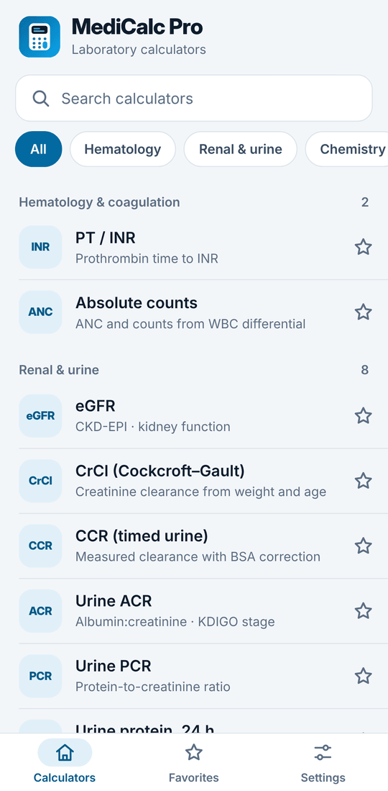
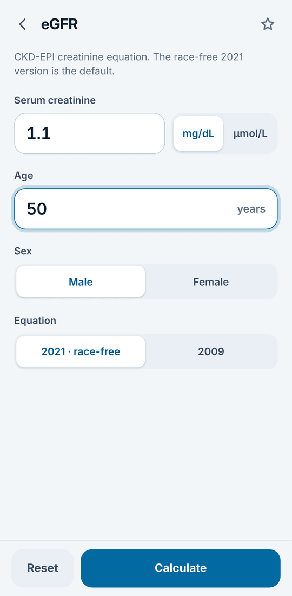
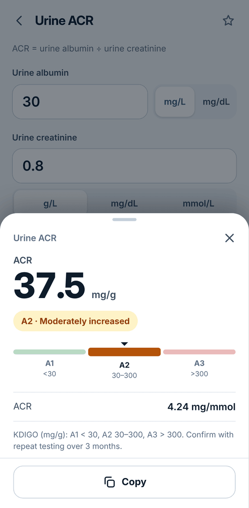
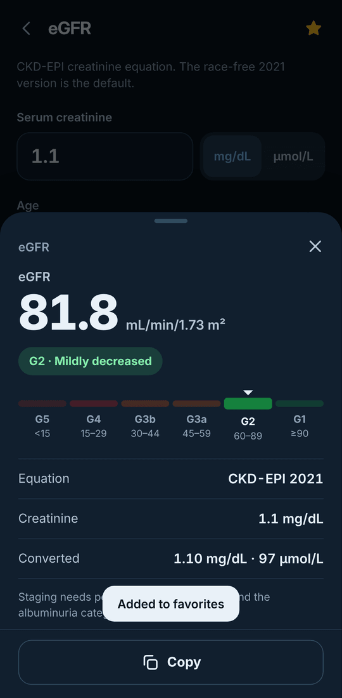

# MediCalc Pro

**Laboratory calculators for clinicians and lab professionals, as a fast, offline-capable Android app.**


<p align="center">
  
  &nbsp;
  
  &nbsp;
  
  &nbsp;
  
</p>

## Contents

- [Features](#features)
- [Calculators](#calculators)
- [Download the APK](#download-the-apk)
- [Try it in a browser or install as a PWA](#try-it-in-a-browser-or-install-as-a-pwa)
- [Build it yourself](#build-it-yourself)
- [Configuration](#configuration)
- [Project structure](#project-structure)
- [Testing](#testing)
- [Adding a calculator](#adding-a-calculator)
- [Known limitations](#known-limitations)
- [Medical disclaimer](#medical-disclaimer)
- [Credits and license](#credits-and-license)

## Features

- **17 calculators** across hematology, renal and urine, chemistry and endocrine work.
- **Built for one hand.** Large inputs, unit toggles instead of dropdowns, and a Calculate button within thumb reach.
- **Results that are easy to read.** A big readout, a stage chip, and a color scale for eGFR (G1 to G5) and urine ACR (A1 to A3), plus the converted inputs, warnings and notes.
- **Safe input handling.** Zero, negative, empty and implausible values are rejected with a clear message next to the field. Typed letters are stripped as you type.
- **Unit aware.** mg/dL, µmol/L, mmol/L, g/L, ng/dL, pmol/L and more are converted for you, and the converted value is shown back.
- **Copy or share** a result together with the inputs that produced it.
- **Search, categories, favorites and recent** calculators.
- **Light, dark or system theme.** Android back button closes the result, then the calculator.
- **Works offline.** No network is needed after install.
- **Typing-friendly for Bangladesh.** Bengali digits (০-৯) and a decimal comma are accepted.
- **Private by design.** Calculator values are never stored. Only favorites, recent calculators and settings stay on the device.

## Calculators

| Group | Calculator | What it does |
| --- | --- | --- |
| Hematology & coagulation | **PT / INR** | INR = (patient PT ÷ MNPT) ^ ISI, plus the ratio and a rough activity estimate |
| | **Absolute counts** | ANC and absolute lymphocyte, monocyte, eosinophil and basophil counts from WBC and differential; warns when the differential does not total 100 % |
| Renal & urine | **eGFR** | CKD-EPI **2021** (race-free, default) or **2009** (optional race factor), with the KDIGO G-stage |
| | **CrCl** | Cockcroft–Gault creatinine clearance |
| | **CCR (timed urine)** | Measured clearance (U × V ÷ P), corrected to 1.73 m² with DuBois BSA |
| | **Urine ACR** | mg/g and mg/mmol with the KDIGO A-stage (A1 < 30, A2 30–300, A3 > 300 mg/g) |
| | **Urine PCR** | Protein-to-creatinine ratio as g/g, mg/g and mg/mmol |
| | **Urine protein, 24 h** | Total protein per day from concentration and volume |
| | **Urine electrolytes, 24 h** | Na⁺, K⁺, Cl⁻ per day (any combination) |
| | **Urine osmolality (est.)** | 2 × (Na + K) + urea + glucose |
| Chemistry | **Serum osmolality (est.)** | 2 × Na + glucose + urea, with an explicit urea / BUN selector |
| | **Anion gap** | With or without K⁺, and optional albumin correction (+ 2.5 × (4.4 − albumin g/dL)) |
| | **CK-MB index** | (CK-MB mass ÷ total CK) × 100 |
| Endocrine | **HOMA** | HOMA1 insulin resistance (IR), beta-cell function (%B) and insulin sensitivity (%S) |
| | **Thyroid units** | TSH, FT4, FT3, total T4 and total T3 converted in both directions |
| | **Free testosterone** | Vermeulen law-of-mass-action solution (albumin and SHBG binding) |
| | **FT3 / FT4 index** | Free hormone index from total hormone and T3 uptake |

## Download the APK

The APK is built automatically by GitHub Actions. No Android Studio is needed.

1. Open the **Actions** tab of this repository.
2. Click the latest run with a green check (workflow **Build Android APK**).
3. Scroll to the bottom of the run page and open **Artifacts**.
4. Download **MediCalc-Pro-debug-apk**. It is a zip file; GitHub requires you to be signed in.
5. Unzip it. Inside is `app-debug.apk`.

### Install on your phone

1. Copy `app-debug.apk` to the phone (Files app, USB, Telegram or Drive).
2. Open it. When Android asks, allow **Install unknown apps** for the app you opened it from.
3. Tap **Install**.

> By default GitHub keeps artifacts for 90 days. To start a fresh build, open **Actions**, choose **Build Android APK** and click **Run workflow**.

This is a **debug** APK, suitable for testing and direct installation. Google Play requires a signed release bundle; see [Build it yourself](#build-it-yourself).

## Try it in a browser or install as a PWA

```bash
npx serve www        # then open the printed address
```

Host the `www/` folder on any HTTPS static host (for example GitHub Pages), open it in Chrome on Android and choose **Install app**. The service worker caches the app so it works offline.

## Build it yourself

**Requirements:** Node 22+, JDK 21 and the Android SDK (installed with Android Studio).

```bash
npm install
npm run android:add     # creates android/ and applies the launcher icons (first time only)
npm run apk             # syncs www/ into Android and builds a debug APK
```

The APK is written to `android/app/build/outputs/apk/debug/app-debug.apk`.

| Command | Purpose |
| --- | --- |
| `npm run sync` | Copy changes from `www/` into the Android project |
| `npm run open` | Open the Android project in Android Studio |
| `npm test` | Run the calculation and registry tests |

On Windows, if `./gradlew` is not recognised, run `gradlew.bat assembleDebug` inside `android/`.

**Releasing on Google Play:** create your own keystore, build a signed release bundle (`.aab`) in Android Studio (**Build → Generate Signed Bundle**) and keep the keystore safe. Change the app id first (see below).

## Configuration

| What | Where |
| --- | --- |
| App id and name | `capacitor.config.json`. `com.imad.medicalc` is a placeholder. **Change it before the first release**, because it cannot be changed later on Google Play. |
| Subscription expiry, renewal link, banner window | `CONFIG` at the top of `www/js/app.js`. Access ends at the end of the expiry day in the device's local time. |
| Version number | `package.json`, `APP_VERSION` in `www/js/app.js`, and `CACHE` in `www/sw.js` (the PWA cache name) |
| Launcher icons | `android-assets/res/` (copied into the Android project during the build) |
| Theme colors and sizes | CSS variables at the top of `www/css/app.css` |

## Project structure

```text
MediCalc-Pro/
├── www/                          the app (this folder ends up inside the APK)
│   ├── index.html
│   ├── manifest.webmanifest      PWA install info
│   ├── sw.js                     offline cache (web build only)
│   ├── css/app.css               themes, layout, components
│   ├── js/calc.js                formulas: pure functions, no DOM
│   ├── js/registry.js            the 17 calculators: fields, validation, result model
│   ├── js/app.js                 screens, navigation, result sheet, settings, subscription gate
│   └── assets/                   Inter fonts (OFL) and icons
├── android-assets/res/           launcher icons applied during the build
├── scripts/apply-android-assets.js
├── tests/                        calc.test.js, registry.test.js, ui.test.js
├── docs/screenshots/             images used in this README
├── .github/workflows/build-apk.yml
├── capacitor.config.json
└── package.json
```

The app is plain HTML, CSS and JavaScript with no framework and no build step. [Capacitor](https://capacitorjs.com) wraps `www/` as an Android app.

## Testing

```bash
npm test
```

Runs the formula tests (`calc.test.js`) and the registry tests (`registry.test.js`). The registry tests push raw form text through the same validation and result code the app uses, for every calculator. At the time of writing that is 41 tests, and the GitHub workflow runs them before building the APK, so a broken formula stops the build.

An optional end-to-end test drives the real interface in an emulated Pixel 7 (95 checks: every calculator, back-button behavior, favorites, dark mode, offline mode, the subscription lock and safe-area insets):

```bash
npm i -D playwright && npx playwright install chromium
node tests/ui.test.js
```

## Adding a calculator

1. **Formula.** Add a pure function to `www/js/calc.js` and export it from the `Calc` object. Add tests with independently computed expected values in `tests/calc.test.js`.
2. **Definition.** Add an entry to `CALCULATORS` in `www/js/registry.js`. It lists the fields (number, choice or switch, with units and limits) and a `compute(values)` function that returns the result model (primary value, chip, scale, rows, warnings, notes).
3. **Tests.** Add a case to `tests/registry.test.js`, then run `npm test`.

The list, search, form, validation, result sheet, copy and share all work automatically from the definition. No new files are added, so `sw.js` does not need to change.

## Known limitations

- **The subscription lock is a deterrent only.** It runs on the device, so someone determined can bypass it (for example by changing the clock or editing the app). Real enforcement needs a licence check against a server.
- **Debug APK only.** The workflow produces a debug-signed APK. Google Play needs a signed release bundle.
- **Native Share and haptics** rely on the official Capacitor plugins and fall back to the browser's own features. They have not been verified on a physical device yet.
- **Needs an up-to-date Android System WebView** (updated through Google Play).
- **Estimates stay estimates.** Calculated osmolality, free testosterone, HOMA1, the FT3 index and the activity value in PT/INR are approximations. Measured values remain the reference.

## Medical disclaimer

MediCalc Pro is a calculation aid for healthcare professionals. It does not replace clinical judgment, and it is not a diagnostic device. Always verify results against your laboratory's validated methods, analyzers and reference ranges before using them for patient care.

## Credits and license

- Developed by **Imad** ([@mrcodeflex](https://github.com/mrcodeflex)).
- Typeface: [Inter](https://rsms.me/inter/), SIL Open Font License 1.1 (see `www/assets/fonts/LICENSE-Inter.txt`).
- Built with [Capacitor](https://capacitorjs.com).

Copyright © 2026 Imad. All rights reserved. No open-source license has been applied to the project code.
